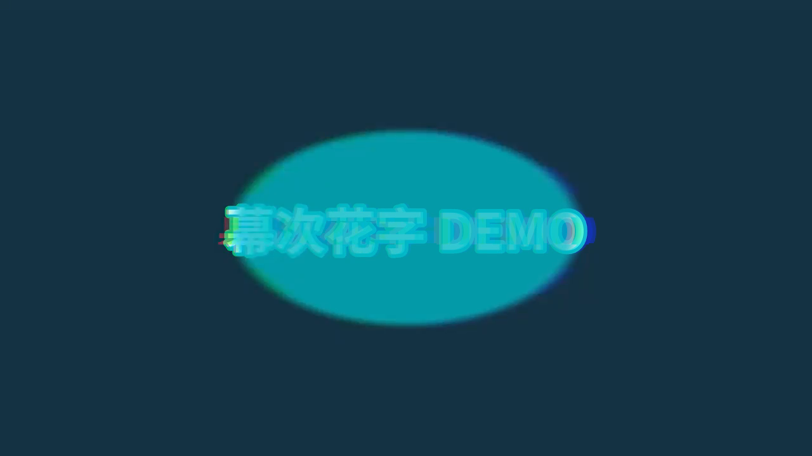

# 幕次 (Marquee)

An **AGPL-3.0-or-later** desktop video editor forked from
[Concat](https://github.com/jub0t/concat) by Jareer Abdullah and contributors.

This product is named **幕次 / Marquee**. It is not Concat and does not use
Concat’s marks or icons. See [ATTRIBUTION.md](ATTRIBUTION.md),
[LICENSE](LICENSE), [LICENSING.md](LICENSING.md) and
[TRADEMARK.md](TRADEMARK.md).

<p align="center">
  
</p>

<p align="center">
  Open-source video editor with a Jianying-style layout and 1300+ original presets.
</p>

## Screenshots

Stills from the editor’s own demo exports (PNG only; evaluation movies are not
part of this source tree).

<p align="center">
  
</p>

<p align="center">
  
</p>

<p align="center">
  
  
</p>

## What it is

幕次 keeps Concat’s local-first Rust engine (GPU compositor, multi-track
timeline, captions, effects) and adds:

- A Jianying-style chrome and Chinese library tabs (original layout work; no
  Jianying assets, fonts, or backends)
- 1300+ original text / sticker / transition / filter presets and 42 layered
  smart-packs
- A JSON-RPC agent API (`concat-cli api`) with copy/paste/duplicate,
  `placement` (`overwrite` / `insert` / `newTrack` / `error`), glossary-aware
  captions, `duckAudio`, and two-pass loudnorm export
- Software-GPU path via `CONCAT_GPU=software` for machines without Vulkan

Engine crate names and JSON-RPC methods still say `concat`. The shipped window
binary is `marquee` and the XDG app id is `app.marquee.editor`.

## Licence and credit

幕次 is free software under [AGPL-3.0-or-later](LICENSE), the same licence as
upstream Concat. That is a copyleft licence: modifications you convey, and a
networked service that lets others interact with a modified version, must
provide corresponding source.

- [ATTRIBUTION.md](ATTRIBUTION.md) — names Concat, the licence, and the rebrand
- [TRADEMARK.md](TRADEMARK.md) — Concat marks stay Concat’s; this fork ships
  only as 幕次 / Marquee (`assets/icons/marquee_logo_*.png`)
- [LICENSING.md](LICENSING.md) — upstream’s note about a commercial option;
  this repository is published as AGPL
- [docs/RELEASE-NOTES.md](docs/RELEASE-NOTES.md) — milestone notes for this fork
- [THIRD_PARTY_NOTICES.md](THIRD_PARTY_NOTICES.md)

Upstream project: [jub0t/concat](https://github.com/jub0t/concat).
The remaining engine documentation (MCP, contributing, locales) still describes
the Concat engine this fork is based on.

## Build and run

You need **Rust 1.93** or newer (see `rust-version` in `src/Cargo.toml`),
**FFmpeg 7+** development libraries, cmake and a C++ compiler.

- **macOS:** `brew install ffmpeg`
- **Windows:** from [FFmpeg’s Windows downloads](https://ffmpeg.org/download.html#build-windows),
  take a BtbN `win64-gpl-shared` or `lgpl-shared` build, unpack it and point
  `FFMPEG_DIR` at it
- **Linux:** use your distro’s FFmpeg if it is version 7 or newer; otherwise
  unpack a BtbN `shared` build and set `FFMPEG_DIR` the same way

Then, from the repository root:

```sh
cd src
cargo run -p concat --bin marquee     # the editor window
```

Other useful commands (also from `src/`):

```sh
cargo build -p concat --bin marquee   # window binary: target/debug/marquee
cargo build -p concat-cli             # JSON-RPC CLI: target/debug/concat-cli
cargo test                            # test suite
```

On a machine without Vulkan, run the window with software compositing:

```sh
CONCAT_GPU=software cargo run -p concat --bin marquee
```

`--project` and `--software` are mutually exclusive on the window; set
`CONCAT_GPU=software` when you also pass `--project`.

Talk to the engine (one JSON object per line):

```sh
echo '{"method":"version"}' | ../target/debug/concat-cli api
# or, after `cargo build -p concat-cli`:
echo '{"method":"version"}' | ./target/debug/concat-cli api
```

The helper scripts `scripts/marquee_agent.py` and `scripts/marquee_http.py`
drive that API. See [docs/AGENT-GUIDE.md](docs/AGENT-GUIDE.md) and
[docs/MCP.md](docs/MCP.md).

If you change user-visible strings, run `python3 scripts/locales.py` from the
repo root. Broader contribution notes live in [CONTRIBUTING.md](CONTRIBUTING.md).

FFmpeg used at build time may live under `vendor/ffmpeg/` on a developer
machine; that prefix is gitignored and is not part of this source release.

## What is not in this tree

Evaluation encodes, tester films, downloaded Whisper model binaries,
`vendor/ffmpeg`, demo caches and private project paths are excluded from the
published history. Caption models download once from Settings (or into
`~/.local/share/app.marquee.editor/`) and work offline after that.

## Engine highlights (from upstream Concat)

- No watermarks, no account, no upload — editing stays on your disk
- Local Whisper captions, text-to-speech, background removal
- Keyframes, multi-track timeline, GPU effects, 4K export
- Scriptable through MCP (`concat --mcp`) and JSON-RPC

## Contributors

<a href="https://github.com/jub0t/Concat/graphs/contributors">
  
</a>

Please report 幕次 issues on this repository. Please report engine issues that
also apply unchanged to Concat upstream at [jub0t/concat](https://github.com/jub0t/concat).
