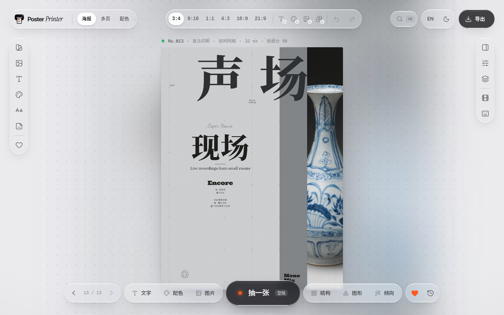
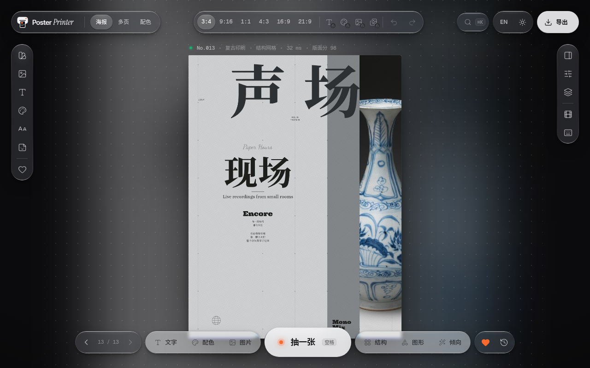

# Ready design system (for 幕次)

Extracted Asia/Tokyo, 8 November 2026, from 白's own apps on this machine
and from public repos under [ALBEDO-TABAI](https://github.com/ALBEDO-TABAI).
This file is the source of truth for restyling 幕次's chrome to match the
**Ready** series. It does not change Jianying-style layout or information
architecture.

## Which apps share it

| App | Path / repo | Shares this chrome? |
|---|---|---|
| Ready Poster Printer | `ready-poster-printer`, `ALBEDO-TABAI/ready-poster-printer` | **Yes — canonical.** Tokens in `src/styles/tokens.css` (production names the faces `PP Sans` / `PP Display` / `PP Mono` / `PP Serif`, which are Inter / Inter Tight / Geist Mono / Instrument Serif). |
| Poster Printer UI prototype | `ready-poster-printer (UI prototype)` | **Yes — same token file**, plus the liquid-glass recipes in `css/glass.css` and component recipes in `css/app.css`. |
| Poster Printer promo film | `promo-poster-printer` | **No.** `film/design/tokens.css` is a paper / moss-green *film* system (SF, `--paper #f5f5f5`, `--green #397953`), not the editor chrome. |
| Stillroom | `stillroom`, `ALBEDO-TABAI/stillroom` | **No.** Goldmund recreation: canvas `#E5E5EA`, accent `#FFA000`, 30px blur. Inter, but a different material set. |
| Inkwell | `inkwell`, `ALBEDO-TABAI/inkwell` | **No.** Notion-like recreation (`packages/tokens`). |
| Tempo | `tempo`, `ALBEDO-TABAI/tempo` | **No.** Calendar recreation, Notion-like blues. |
| Ready Cinema, ReadyCapture, ready-library | GitHub only (`ALBEDO-TABAI/ready-cinema`, `ReadyCapture`, `ready-library`) | Related product names; not used as token sources here (Cinema/Capture are native apps with their own media chrome). |

`gh` on this box was not logged in; repo inventory used the connected GitHub
account (`search_repositories` on `user:ALBEDO-TABAI`).

## Source screenshots

Copied from the prototype / product captures that already exist (they *are*
screenshots of Ready Poster Printer, not reconstructions):

- `docs/design/ready-source/poster-printer-light.png` — default light shell
- `docs/design/ready-source/poster-printer-dark.png` — default dark shell
- `docs/design/ready-source/poster-printer-inspector.png` — inspector sheet
- `docs/design/ready-source/poster-printer-library.png` — library / styles
- `docs/design/ready-source/poster-printer-advanced.png` — advanced panel
- `docs/design/ready-source/poster-printer-product.jpg` — shipped product poster stage

## Palette

Light is the default in Poster Printer; 幕次 still defaults to dark (a video
editor's monitor wants a dark room) but both palettes are retuned.

| Token | Light | Dark | Role |
|---|---|---|---|
| stage / page | `#ebebee` | `#0b0b0d` | Window ground |
| stage-2 | `#e3e3e8` | `#111114` | Slightly deeper ground, wells |
| glass tint | `rgb(252 252 253)` ≈ `#fcfcfd` | `rgb(28 28 32)` ≈ `#1c1c20` | Floating panes |
| ink / fg | `#0b0b0e` | `#f4f4f6` | Primary text |
| ink-2 | 64% ink | 66% ink | Secondary |
| ink-3 | 42% ink | 42% ink | Tertiary / captions |
| hair | 8% ink | 8% white | Hairline |
| hair-2 | 14% ink | 14% white | Stronger hairline |
| fill / fill-2 / fill-3 | 4.5% / 8% / 13% ink | 5% / 8.5% / 13% white | Idle / hover / press wells |
| **accent** | `#ff5a1f` | `#ff6a2c` | “Print signal” — the one accent |
| accent-ink | `#ffffff` | `#ffffff` | Text on accent |
| accent-soft | 14% accent | 18% accent | Selected-row wash |
| ok | `#1fae6b` | `#1fae6b` | Success |
| warn | `#e2a400` | `#e2a400` | Warning |
| bad | `#e5484d` | `#e5484d` | Destructive |

## Typography

| Role | Face | Licence | Notes |
|---|---|---|---|
| UI | Inter (`PP Sans`) | SIL OFL 1.1 | Already in `src/crates/concat-text/fonts/Inter-*.ttf` + `LICENSE-Inter.txt` |
| Display | Inter Tight (`PP Display`) | SIL OFL 1.1 | Wordmarks in Poster Printer; 幕次 uses Inter at 600/700 instead of shipping another family |
| Mono | Geist Mono (`PP Mono`) | SIL OFL 1.1 | Prototype `ready-poster-printer (UI prototype)/assets/fonts/GeistMono.woff2`. Not bundled into 幕次 (no static TTF in this tree); technical UI stays Inter |
| Serif accent | Instrument Serif (`PP Serif`) | SIL OFL 1.1 | Italic wordmark flourish in Poster Printer only |
| CJK UI | Noto Sans SC UI subset | SIL OFL 1.1 | Prototype `NotoSansSC-ui.woff2`; 幕次 already falls back through bundled CJK title fonts / system PingFang / Noto |

Scale (Poster Printer `:root`):

| Token | Size | 幕次 `Theme` |
|---|---|---|
| `--fs-2xs` | 10px | `fs-xs` |
| `--fs-xs` | 11px | `fs-sm` |
| `--fs-sm` | 12px | (skip — body moved to 13) |
| `--fs-md` | 13px | `fs` |
| `--fs-lg` | 15px | `fs-lg` / `fs-input` |
| `--fs-xl` | 17px | `fs-xl` |
| `--fs-2xl` | 22px | — |
| `--fs-3xl` | 28px | `fs-display` |
| `--fs-4xl` | 40px | — (too large for an editor) |

Line-height `--lh` 1.45, `--lh-tight` 1.15. Tracking `--tracking-tight` −0.02em
on display; `--tracking-caps` 0.06em on eyebrows.

Weights: body 400, titles / wordmark 600, display 700 (Ready wordmark is 600
on Inter Tight). Feature settings in the prototype: `'cv11', 'ss01', 'ss03'`.

## Space, radius, motion

Spacing is a **4px atom** that lands on an 8pt grid: `--s1` 4, `--s2` 8,
`--s3` 12, `--s4` 16, `--s5` 20, `--s6` 24, `--s8` 32, `--s10` 40, `--s14` 56.

Radii (concentric: inner = outer − padding):

| Token | Value | 幕次 `Theme` |
|---|---|---|
| `--r-xs` | 6px | `r-xs` |
| `--r-sm` | 9px | `r-sm` |
| `--r-md` | 12px | `r` |
| `--r-lg` | 16px | `r-lg` |
| `--r-xl` | 22px | `r-xl` |
| `--r-2xl` | 28px | — |
| `--r-pill` | 999px | floating pills in Poster Printer; 幕次 keeps dense 28px controls |

Motion: `--ease-out` `cubic-bezier(.22, 1, .36, 1)`, `--ease-in-out`
`cubic-bezier(.65, 0, .35, 1)`, `--ease-spring` `cubic-bezier(.34, 1.56, .64, 1)`,
`--ease-liquid` `cubic-bezier(.3, .7, .2, 1)`. Durations 120 / 200 / 320 /
480 / 640 ms.

## Glass, blur, shadow

Poster Printer's `.lg` material (see `css/glass.css`):

1. Backdrop: `blur(22px) saturate(185%)` (dark: 170%).
2. Body tint: glass-tint RGB at alpha 0.52 (strong 0.62, clear 0.30), plus a
   poster-ambient wash (`--amb` at 10–14%).
3. Inner specular line (top) and contact shade (bottom).
4. 1px gradient rim whose angle follows the pointer.
5. Soft caustic under the top edge.

Shadows (light): `--shadow-1` tight contact, `--shadow-2` pane, `--shadow-3`
sheet, `--shadow-4` hero. Dark shadows are the same recipe with black at
0.35–0.8.

**Slint has no backdrop-filter.** 幕次 emulates the *taste* by painting the
glass tint as an opaque pane (`#fcfcfd` / `#1c1c20`) on a slightly different
page (`#ebebee` / `#0b0b0d`), with Ready hairlines instead of hard outlines.
That is the same trick Poster Printer uses when
`prefers-reduced-transparency` is on (solid glass-tint, no lens).

## Components (Poster Printer)

- **Title / top bar:** 48px tall, 16px inset, pill capsules (`border-radius: 999px`).
  Brand: Inter Tight 600 15px + optional Instrument Serif italic 17px.
- **Icon button:** 36×36 pill; hover `fill`; active icon uses accent.
- **Primary button:** 48px pill, inverse glass (`lg.ink`) or accent fill,
  weight 600, press scale 0.94 with spring release.
- **Segmented control:** pill track (`fill` + inset hair), sliding white
  (light) / 16% white (dark) thumb, 30px segments.
- **Left/right rail:** 52px wide, 26px outer radius, 40px circular items,
  selected state shows a 2px accent tick on the outer edge.
- **Cards / inspector:** `r-xl` 22px glass sheet, 16px padding, hairline +
  `--shadow-2`.
- **Slider:** accent fill on the travelled track; light grip chip (not the
  accent — the track *is* the accent).
- **Tabs:** segmented or underline; selected label `ink`, idle `ink-2`.
- **Tooltip:** inverse (`--inverse` / `--on-inverse`), 8px radius, `--shadow-2`.

## How 幕次 applies it

Everything the interface reads is in `src/crates/concat/ui/theme/`:

- `light.slint` / `dark.slint` — Ready stage, ink, hair, Print-signal first
  accent, ok/danger, page, lanes.
- `theme.slint` — Inter, the type scale above, radii, `gap` 8px, `pad` 16px.
  Control height `h` stays **28px** (Jianying density).
- `app.slint` — imports Inter Regular / SemiBold / Bold / Italic.

The first Settings accent (still keyed as `settings.lime` so preference IDs
and the other 23 locales stay stable) now *wears* Print signal. English /
简体 / 繁中 labels read Print / 印记 / 印記. Other accents (sky, violet,
rose, amber, mint) remain choosable.

Media-kind hues, clip ink, waveform colours and the black monitor stage are
left alone: they name *edit contents*, not chrome, and a light theme must not
relight the footage (existing theme contract).

## Judgement calls

1. Ready chrome comes from Poster Printer, not from Inkwell / Tempo / Stillroom
   or the promo film.
2. 幕次 stays dark-by-default.
3. No real blur: opaque glass-tint panes.
4. No Geist Mono / Inter Tight / Instrument Serif shipped for chrome.
5. 28px controls instead of 36px pills, so the Jianying timeline still fits.
6. First accent slot keeps the `lime` preference id; only the colour and the
   three translated labels change.
7. Playhead default follows Print signal (it used to be a leftover lime /
   teal) so the eye's “now” mark matches the one accent.
